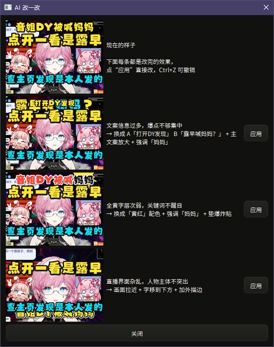
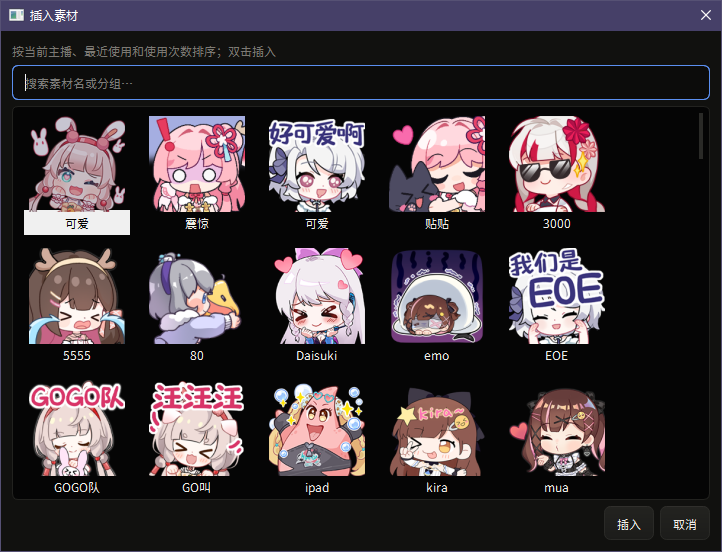
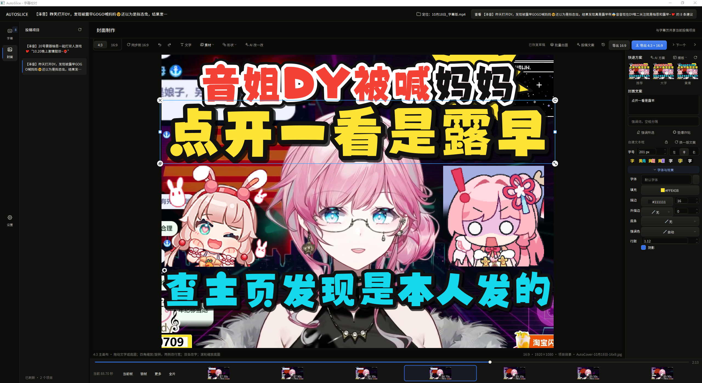

# 桌面端改进清单（含字幕研究）

> 作用：把“还有什么可以调整优化”落成有依据、有优先级的清单。依据来自代码阅读，以及用学习旧切片的框架分析一条**真实**切片（泽音那条，147 条字幕，初稿 + 校对稿）得到的数字。已经做完的标了“已做”。
> 学习旧切片的规格、数据约定和接手待办见 [ARCHIVE_LEARNING.md](ARCHIVE_LEARNING.md)。

## 1. 字幕研究：真实数据长什么样

那条真实字幕（剪映识别断句风格）：

| 指标 | 数值 |
|---|---|
| 条数 / 校对改动 | 147 条 / 7 处（约 5%） |
| 一条字数 | 中位 9，90 分位 14，最长 16；全部单行、**没有任何标点** |
| 读速（字/秒） | 中位 5.0，90 分位 6.5，最快 9.0 |
| 单条时长 | 0.8 ~ 4.1 秒 |
| 相邻两条间隔 | 中位 0.17 秒；**55/146 对几乎无缝（<0.05 秒）**，84/146 对 <0.3 秒（同一句话被切开） |
| 含英文/数字的条目 | 22 条（AI、ins、emoji、get、101…） |

7 处改动的性质：

| 类型 | 例子 |
|---|---|
| 同音/近音误识别（4 处） | 教个→交个；有教→要交；竞选→竞演；干外→场外 |
| 外来词被听成中文（2 处） | 意思上面改→**ins**上面改；一模一→**emoji** |
| 识别断句漏出的字（1 处） | `…101系选` ┃ `选秀都是…`（“选”同时出现在上一条末尾和下一条开头） |

结论：

1. **现有通用质量提醒太松**：阈值是“超过 2 行、超过 34 字、短于 0.65 秒”，这条字幕上**一条都没标出来**；而用户自己的习惯是“一条 ≤16 字、读速 ≤9”。按本片习惯（读速 7.2、一条 15、单行 15）能标出 9 条。→ 已做个性化阈值（学过旧切片才启用）。
2. **边界重复**是识别断句特有的错误，规则很便宜：上一条末尾的字和下一条开头相同、间隔 ≤0.3 秒、两条各 ≥6 字、末尾不是“对对”这种连续重复。在这条上命中 1/1，校对后 0 处，误报 0。→ 已做，所有人都生效。
3. **外来词/英文**最容易被听成中文（ins、emoji、get到、AI、QQ）。靠“意思→ins”这种固定纠错不行（“意思”大多数时候是对的），要靠上下文和精度。→ 学习框架已加“精度”检查；专项提示见下表。
4. 用户已经**关掉了预览和压制的自动换行**（保留原文、分条、时间轴，`WrapStyle: 2`）：不要再做自动重排。
5. 现有 `correction_memory`（保存校对时学错词）只要两个视频都改过就写进词库，**没有精度检查**，同样会把“意思→ins”这类写进去改坏。

## 2. 字幕：建议的改动

| # | 改动 | 依据 | 成本 | 状态 |
|---|---|---|---|---|
| S1 | 边界重复提醒 | 真实数据 1/1 命中、0 误报 | 小 | **已做** |
| S2 | 质量提醒按个人习惯定阈值 | 通用阈值标 0 条、个人阈值标 9 条 | 小（依赖学习旧切片） | **已做** |
| S3 | 固定纠错带精度检查（学习旧切片里） | “意思→ins”会改坏每个“意思” | 小 | **已做**（`correction_memory` 里还没有，见 ARCHIVE_LEARNING P1） |
| S4 | AI 检查带“和当前字幕有关的学到的术语”，不整份塞 | 术语表 ≤200 条、旧切片能学出成千上万 | 小 | **已做** |
| S5 | 同音检测：用拼音找“发音相同但字不同”的片段对照术语表，作为不花钱的建议来源，AI 只做仲裁 | 4/7 处改动是同音或近音 | 中 | **已做**（D-033；pypinyin 已加进 requirements-qt-desktop.txt；近音如 xuan/yan 没做） |
| S6 | AI 提示里加“外来词易被听成中文”专项 + 把采纳/跳过的反馈回灌（总被跳过的类型少提） | 2/7 处是外来词；反馈数据已经在 `cache/ai/session-*.json` | 中 | 待办 |
| S7 | “应用已学固定纠错”：一键列出当前字幕里命中的条目，预览后批量应用，可撤销 | 固定纠错只在 AI 检查时作为映射，用户看不到命中 | 中 | 待办 |
| S8 | 字幕压制样式可调（字体、字号、描边、位置），现在设置页只显示默认样式文字 | 预览已用 ASS，`build_ass_document` 已支持 style 参数 | 中 | 待办（要你确认想调哪些） |
| S9 | 保存前汇总提醒（读速/重复/过长/重叠）+ “下一个提醒”快捷键 | 提醒现在只在状态栏计数、鼠标悬停才看到明细 | 小 | 待办 |

## 3. 桌面端其它

| # | 项 | 说明 | 状态 |
|---|---|---|---|
| D1 | 打包成安装器 | `packaging/` 里已有 spec、iss 和构建脚本，见 [PACKAGING.md](PACKAGING.md)；在你的主力机上运行 | **脚本已写，待你构建验证** |
| D2 | CI 上 Windows 检查有 3 项失败 | 作者推送说明里提到：路径比较和时间轴鼠标样式，没处理 | 待办 |
| D3 | 真实窗口验收 | DPI、字体 fallback（标题里的 emoji）、动效手感、菜单靠屏幕边缘时的位置，我只在离屏环境验证过 | 需要你实机看 |
| D4 | 字幕表格在“待确认”筛选时每次取行都重建列表（`SubtitleTableModel.visible_entries`） | 150 条无感；长视频（上千条）筛选后绘制会变成 O(n²)，缓存即可 | 待办（低） |
| D5 | 旧封面学习 → “你的常用版式”预设 | 见 ARCHIVE_LEARNING P2 | 待 GPT |
| D6 | 标题系列模板与标题公式 | 见 ARCHIVE_LEARNING P2 | 待 GPT |
| D7 | 导入播放量/点击率（你自己从创作中心导出 CSV），分析哪种标题/封面表现好 | 把“学你的习惯”升级成“学什么有效” | 待 GPT |
| D8 | 封面“AI 改一改”的方案预览需要调整 | 每套方案左右并排对照原图和效果图，操作说明逐行显示，支持应用和撤销 | **已实现，用户实机验收中** |
| D9 | 封面文字块居中时，以中心为锚点等比例缩放 | 只在文字块位于画布水平中间时固定中心向四周伸缩；偏左、偏右保持旧缩放方式 | **已按用户二次澄清修正，待复测** |
| D10 | 素材范围、搜索与素材完整性 | 取消前 120 张限制；设置页选择素材文件夹；搜索包含完整子目录名 | **已实现，待用户按自己的文件夹复测** |
| D11 | “AI 改一改”优化描边配色 | 所有可编辑文字块均可得到独立的描边、外描边建议，预览与应用使用同一份文档 | **已实现，待实机评价配色** |
| D12 | 投稿项目排序入口缺失 | 恢复创建时间、文件夹修改时间、视频修改时间、名称排序，记住选择且不切换当前项目 | **已实现，待实机复测** |
| D13 | 手动滚动后点字幕跳回旧位置 | 修复按下到松开之间用旧选中行恢复列表的问题，覆盖第 50 条滚回第 3 条再点击 | **已复现并修复，待实机复测** |

## 4. 桌面端取代网页端：还差什么

只读了旧网页版的路由和模块名对照，没逐项实测。

| 旧网页版功能 | 桌面端现状 | 差距 |
|---|---|---|
| 字幕工作流（扫描、校对、AI 检查、预览、压制、保存） | 已有，且更好 | 无 |
| 字幕识别 | **本次补上**（D-032） | 主机上验证、`bench` 选引擎 |
| 封面（AutoCover） | 已有，且更好 | 无 |
| 投稿标题/文案生成 | 封面页里有（带学到的标题范例） | 字幕页入口可以再顺一点 |
| **话题分析切片主流程**（扫描录播 → 识别 → LLM 话题分析 → 报告 → 切片 → 精剪时间线，`/api/start-pipeline`） | **没有** | **最大的一块**：流水线代码（`pipeline*.py`、`analysis/`）不依赖 Flask，可以直接包成桌面端服务；字幕阶段注入新引擎即可 |
| 直接切片（`/direct-slice`）、手动时间轴上传、`retry-clip-review`、`optimize-manual-timeline` | 没有 | 跟着流水线一起搬 |
| 任务中心（事件流、取消、任务历史） | 各功能自己的进度条 | 流水线进来后需要统一的任务面板 |
| 主播配置管理、固定纠错管理 | 靠学习旧切片和校对记忆间接维护 | 缺一个直接查看/编辑的页面 |
| ASR/GPU 安装脚本（`setup_asr_model.py`、`setup_gpu_runtime.py`） | `doctor` / `setup` | 够用 |

建议顺序：①在主机上跑通识别并用 `bench` 定引擎 → ②把切片流水线包成桌面端服务（识别已就绪，是它的第一步）→ ③直接切片/时间轴 → ④任务面板与配置页 → ⑤打包安装器（D1，需要你同意下载 PyInstaller / Inno Setup）→ 网页版降为只读兼容。

## 5. 更多想法

1. **检索式记忆而不是塞提示词**：旧切片能学出成千上万条术语/标题；每次只挑和当前视频最像的几十个/几个给 AI（已按这个做，`Knowledge`）。之后可以用 embedding 把检索做得更准。
2. **三级输出**：`report.md` 给人看、`digest.json` 给 GPT 看（几十 KB）、`archive.db` 只留本机。你可以只把 digest 交给 GPT，原始数据永远不用离开电脑。
3. **“学什么有效”比“学你的习惯”更值钱**：加上播放量/点击率，才能知道哪种标题公式、哪种封面配色更好，而不只是复刻过去。
4. **本地先、AI 后**：同音检测、边界重复、术语命中都是本地零成本规则，AI 只处理本地拿不准的，既省额度也更快。
5. **旧切片还能反过来训练默认值**：默认字幕阈值、默认封面配色、默认标题长度，都可以从你自己的分布里取，而不是我拍脑袋的 34 字。

## 6. 用户截图反馈：封面“AI 改一改”（2026-10-18）

- 用户原话：“这种需要调，但暂时先别调，记下来”。
- 涉及界面：封面页“AI 改一改”弹窗，包含当前封面、三种建议的预览、方案说明和“应用”按钮。
- 状态：用户随后授权实施。已改为方案分页，每页将当前封面和修改效果等宽并排，图片保持比例，说明逐行显示；应用、撤销、重做在弹窗内完成。
- 后续检查点：预览与说明的排布、文字拥挤情况，以及各建议方案实际封面效果的辨识度。以上是待检查方向，尚未确定具体改法或认定根因。
- 验证：覆盖小窗口排布、候选切换、应用与预览渲染一致、撤销重做，以及旧方案不覆盖新编辑或其它项目。桌面控制工具连续截图超时，原生鼠标验收由用户接手；离屏组件渲染不算实机手感验收。

## 7. 用户截图反馈：封面文字块中心缩放（2026-10-18）

- 用户原话：“字幕块居中时，这个调节放大缩小不是在中间等比例放大的，我不太习惯，我想要像之前网页版类似的那种”。
- 涉及对象：截图中封面画布内选中的文字块及其缩放手柄，不是字幕时间轴上的条目。
- 期望行为：2026-10-19 用户进一步明确，操作是拖右下角手柄；只有文字块位于画布水平中间时，以自身中心为固定锚点向四周等比例伸缩。没有居中的文字保留之前的普通缩放方式，不得把所有文字统一改成中心缩放。
- 后续验收：对照旧网页版核实手柄行为；检查居中文字放大及缩小后的中心与宽高比例、连续拖动反馈、预览与导出一致性，以及撤销恢复。
- 状态：已按二次澄清修正。居中判定沿用画布的 8 像素吸附容差；段落“居中对齐”本身不代表文字块位于画布中间。覆盖两种比例、旋转、连续放大缩小，以及偏左／偏右的普通缩放。

## 8. 用户截图反馈：素材库不全（2026-10-18）

- 用户原话：“素材库不全”。
- 涉及界面：封面页“插入素材”弹窗，包含素材搜索、缩略图网格和插入操作。
- 问题事实：旧选择器只显示前 120 张；搜索也只覆盖这 120 张。首次修复扩大到 710 张后，用户指出范围过大、混入杂图，且搜“泽音”没有结果；根因还包括分组只保留最末级目录名。
- 实施：保留完整索引和按需缩略图，设置页新增“素材文件夹”选择并本机持久化；只扫描所选目录及子目录，另保留用户手动导入。旧网页导入不再自动混入。完整相对目录用于搜索和主播优先，例如“表情包/泽音/常用”。
- 后续验收：已存在且受支持的素材可在素材库中找到、搜索并插入；确认缺项前不下载或替换用户素材。
- 状态：已修正范围和搜索；当前原始配置目录的隔离只读扫描可搜到 20 张“泽音”素材。总数随所选目录变化，不再以全量 710 张作为验收标准。待用户在设置中选择实际需要的素材文件夹并复测。

## 9. 用户截图反馈：“AI 改一改”优化描边配色（2026-10-18）

- 用户原话：“描边颜色有调整的空间，有朋友反馈这种描边颜色不好看，AI 改一改时可以优化一下”。
- 涉及功能：封面文字的描边、外描边配色，以及“AI 改一改”的建议生成与效果预览。
- 期望行为：AI 结合文字填色、背景明暗和整张封面的风格优化描边配色，兼顾清晰度、层次与观感；不要只修改文案或填充色。
- 约束：这是针对当前效果的配色反馈，不等于所有封面统一禁止深色描边；具体颜色方案尚未确定。
- 后续验收：候选预览能看见描边颜色的实际变化；应用结果与预览一致，并能撤销恢复用户原来的样式。
- 状态：已实现独立描边建议，支持自定义第三行文字；颜色与对象 ID 均校验，锁定文字不改，单独优化描边时保留文案、填色、字号和位置。已验证效果预览、应用与撤销，真实 AI 的审美效果待用户实际使用评价。

## 10. 封面“AI 改一改”支持自定义对象并筛选成品（2026-10-19）

- 用户要求：自己加的文字也能有效调整；适应不同内容、文字数量和构图；筛掉没变化、近似重复或变差的候选。
- 实现：向 AI 提供当前文字、图片、贴纸、形状与背景的状态，按对象 ID 调整；保留正文、手动换行与锁定内容，关联爆炸贴跟随文字几何。位置与尺寸按当前比例保存，文字样式沿用编辑器共享规则。
- 筛选：渲染后检查两种比例是否新增截字、严重文字挤压或素材出界，再排除无感变化与近似重复；把原图与剩余候选一起交给看图模型复核，最多展示三套有具体改善理由的方案，允许原图胜出。
- 约束：保留原有风格和有意的裁切、叠放；多人与无人画面、游戏、物品和任意数量文字不使用固定三行模板。复核失败显示错误，不应用未复核候选；预览、应用、撤销沿用同一份文档。
- 验证：离线模拟覆盖逐对象修改、两种比例、锁定与隐藏、混合文字、装饰跟随、无文字封面、原图胜出、复核失败及预览应用撤销。真实 AI 的审美效果仍需实际使用评价。
