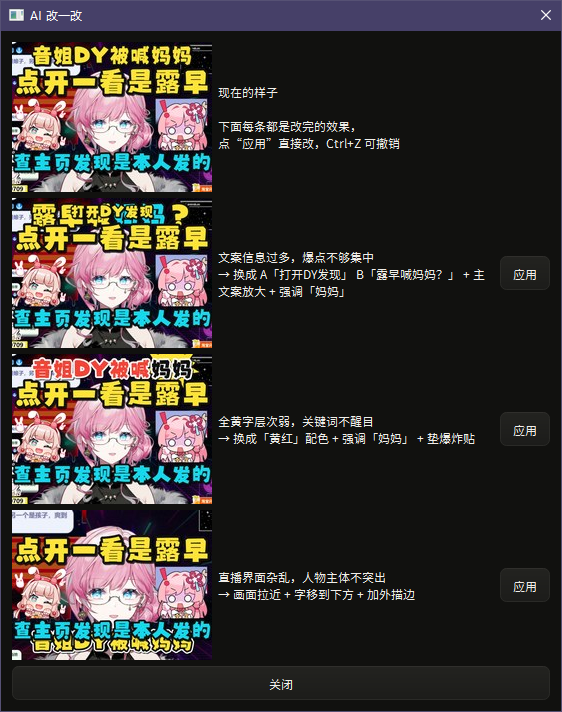
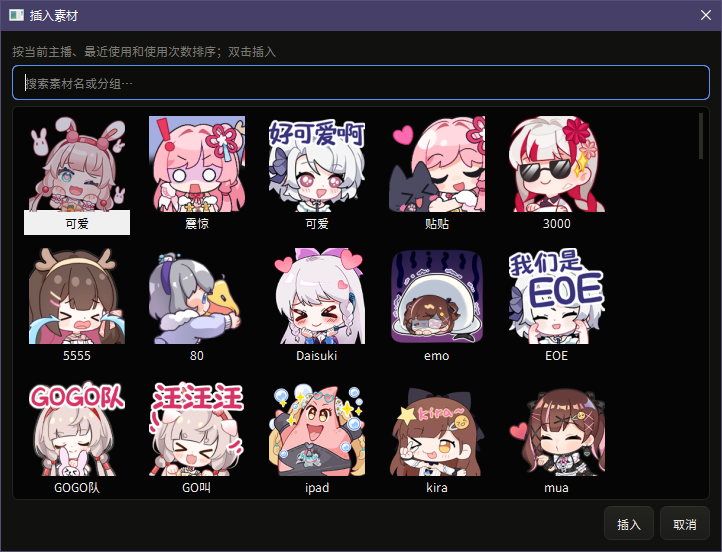
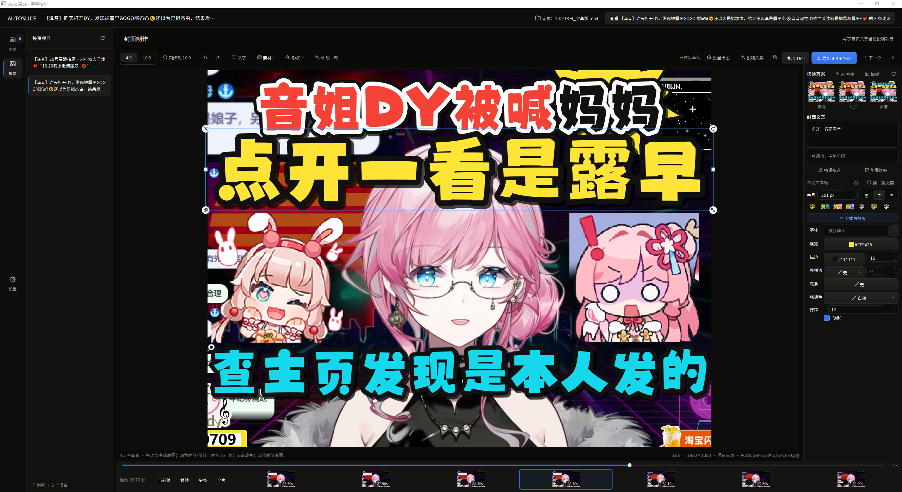

# 桌面端改进清单（含字幕研究）

> 作用：把“还有什么可以调整优化”落成有依据、有优先级的清单。依据来自代码阅读，以及用学习旧切片的框架分析一条**真实**切片（泽音那条，147 条字幕，初稿 + 校对稿）得到的数字。已经做完的标了“已做”。
> 学习旧切片的规格、数据约定和接手待办见 [ARCHIVE_LEARNING.md](ARCHIVE_LEARNING.md)。

## 1. 字幕研究：真实数据长什么样

那条真实字幕（剪映识别断句风格）：

| 指标 | 数值 |
|---|---|
| 条数 / 校对改动 | 147 条 / 7 处（约 5%） |
| 一条字数 | 中位 9，90 分位 14，最长 16；全部单行、**没有任何标点** |
| 读速（字/秒） | 中位 5.0，90 分位 6.5，最快 9.0 |
| 单条时长 | 0.8 ~ 4.1 秒 |
| 相邻两条间隔 | 中位 0.17 秒；**55/146 对几乎无缝（<0.05 秒）**，84/146 对 <0.3 秒（同一句话被切开） |
| 含英文/数字的条目 | 22 条（AI、ins、emoji、get、101…） |

7 处改动的性质：

| 类型 | 例子 |
|---|---|
| 同音/近音误识别（4 处） | 教个→交个；有教→要交；竞选→竞演；干外→场外 |
| 外来词被听成中文（2 处） | 意思上面改→**ins**上面改；一模一→**emoji** |
| 识别断句漏出的字（1 处） | `…101系选` ┃ `选秀都是…`（“选”同时出现在上一条末尾和下一条开头） |

结论：

1. **现有通用质量提醒太松**：阈值是“超过 2 行、超过 34 字、短于 0.65 秒”，这条字幕上**一条都没标出来**；而用户自己的习惯是“一条 ≤16 字、读速 ≤9”。按本片习惯（读速 7.2、一条 15、单行 15）能标出 9 条。→ 已做个性化阈值（学过旧切片才启用）。
2. **边界重复**是识别断句特有的错误，规则很便宜：上一条末尾的字和下一条开头相同、间隔 ≤0.3 秒、两条各 ≥6 字、末尾不是“对对”这种连续重复。在这条上命中 1/1，校对后 0 处，误报 0。→ 已做，所有人都生效。
3. **外来词/英文**最容易被听成中文（ins、emoji、get到、AI、QQ）。靠“意思→ins”这种固定纠错不行（“意思”大多数时候是对的），要靠上下文和精度。→ 学习框架已加“精度”检查；专项提示见下表。
4. 用户已经**关掉了预览和压制的自动换行**（保留原文、分条、时间轴，`WrapStyle: 2`）：不要再做自动重排。
5. `correction_memory`（保存校对时学错词）现在也有精度检查：至少 2 个视频改过（`MIN_VIDEOS`），并且改的次数占“改 + 留着原写法”的八成以上（`MIN_PRECISION = 0.8`，留着没改的算 `kept`）才记住；精度不够的留在“观察中”，不会自动改字。（2026-11-12 校准：早先这里写的是“没有精度检查”。）

## 2. 字幕：建议的改动

| # | 改动 | 依据 | 成本 | 状态 |
|---|---|---|---|---|
| S1 | 边界重复提醒 | 真实数据 1/1 命中、0 误报 | 小 | **已做** |
| S2 | 质量提醒按个人习惯定阈值 | 通用阈值标 0 条、个人阈值标 9 条 | 小（依赖学习旧切片） | **已做** |
| S3 | 固定纠错带精度检查（学习旧切片里） | “意思→ins”会改坏每个“意思” | 小 | **已做**（`correction_memory` 也已有：≥2 个视频、精度 ≥0.8 才记住） |
| S4 | AI 检查带“和当前字幕有关的学到的术语”，不整份塞 | 术语表 ≤200 条、旧切片能学出成千上万 | 小 | **已做** |
| S5 | 同音检测：用拼音找“发音相同但字不同”的片段对照术语表，作为不花钱的建议来源，AI 只做仲裁 | 4/7 处改动是同音或近音 | 中 | **已做**（D-033；pypinyin 已加进 requirements-qt-desktop.txt；近音如 xuan/yan 没做） |
| S6 | AI 提示里加“外来词易被听成中文”专项 + 把采纳/跳过的反馈回灌（总被跳过的类型少提） | 2/7 处是外来词；反馈数据已经在 `cache/ai/session-*.json` | 中 | 待办 |
| S7 | “应用已学固定纠错”：一键列出当前字幕里命中的条目，预览后批量应用，可撤销 | 固定纠错只在 AI 检查时作为映射，用户看不到命中 | 中 | **已做**（2026-11-12）：本地检查列出命中后，AI 面板“全部采纳本地纠错（N 条）”先列出要改的内容再一次采纳，一步撤销；只收主播固定纠错和已记住的改法，同音字、观察中的仍逐条看；原文被手改过的跳过 |
| S8 | 字幕压制样式可调（字体、字号、描边、位置），现在设置页只显示默认样式文字 | 预览已用 ASS，`build_ass_document` 已支持 style 参数 | 中 | 待办（要你确认想调哪些） |
| S9 | 保存前汇总提醒（读速/重复/过长/重叠）+ “下一个提醒”快捷键 | 提醒现在只在状态栏计数、鼠标悬停才看到明细 | 小 | 待办 |

## 3. 桌面端其它

| # | 项 | 说明 | 状态 |
|---|---|---|---|
| D1 | 打包成安装器 | `packaging/` 里已有 spec、iss 和构建脚本，见 [PACKAGING.md](PACKAGING.md)；在你的主力机上运行 | **脚本已写，待你构建验证** |
| D2 | CI 上 Windows 检查有 3 项失败 | 作者推送说明里提到：路径比较和时间轴鼠标样式，没处理 | 待办 |
| D3 | 真实窗口验收 | DPI、字体 fallback（标题里的 emoji）、动效手感、菜单靠屏幕边缘时的位置，我只在离屏环境验证过 | 需要你实机看 |
| D4 | 字幕表格在“待确认”筛选时每次取行都重建列表（`SubtitleTableModel.visible_entries`） | 实测画一屏：1000 条 36 毫秒、3000 条 100 毫秒 | **已做**（2026-11-11）：按列表身份、长度和筛选集合缓存行位置，取行时核对编号；3000 条降到约 2 毫秒 |
| D5 | 旧封面学习 → “你的常用版式”预设 | 见 ARCHIVE_LEARNING P2 | 待 GPT |
| D6 | 标题系列模板与标题公式 | 见 ARCHIVE_LEARNING P2 | 待 GPT |
| D7 | 导入播放量/点击率（你自己从创作中心导出 CSV），分析哪种标题/封面表现好 | 把“学你的习惯”升级成“学什么有效” | 待 GPT |
| D8 | 封面“AI 改一改”的方案预览需要调整 | 每套方案左右并排对照原图和效果图，操作说明逐行显示，支持应用和撤销 | **已实现，用户实机验收中** |
| D9 | 封面文字块居中时，以中心为锚点等比例缩放 | 只在文字块位于画布水平中间时固定中心向四周伸缩；偏左、偏右保持旧缩放方式 | **已按用户二次澄清修正，待复测** |
| D10 | 素材范围、搜索与素材完整性 | 取消前 120 张限制；设置页选择素材文件夹；搜索包含完整子目录名 | **已实现，待用户按自己的文件夹复测** |
| D11 | “AI 改一改”优化描边配色 | 所有可编辑文字块均可得到独立的描边、外描边建议，预览与应用使用同一份文档 | **已实现，待实机评价配色** |
| D12 | 投稿项目排序入口缺失 | 恢复创建时间、文件夹修改时间、视频修改时间、名称排序，记住选择且不切换当前项目 | **已实现，待实机复测** |
| D13 | 手动滚动后点字幕跳回旧位置 | 修复按下到松开之间用旧选中行恢复列表的问题，覆盖第 50 条滚回第 3 条再点击 | **已复现并修复，待实机复测** |

## 4. 桌面端取代网页端：还差什么

只读了旧网页版的路由和模块名对照，没逐项实测。

| 旧网页版功能 | 桌面端现状 | 差距 |
|---|---|---|
| 字幕工作流（扫描、校对、AI 检查、预览、压制、保存） | 已有，且更好 | 无 |
| 字幕识别 | **本次补上**（D-032） | 主机上验证、`bench` 选引擎 |
| 封面（AutoCover） | 已有，且更好 | 无 |
| 投稿标题/文案生成 | 封面页里有（带学到的标题范例） | 字幕页入口可以再顺一点 |
| **话题分析切片主流程**（扫描录播 → 识别 → LLM 话题分析 → 报告 → 切片 → 精剪时间线，`/api/start-pipeline`） | **没有** | **最大的一块**：流水线代码（`pipeline*.py`、`analysis/`）不依赖 Flask，可以直接包成桌面端服务；字幕阶段注入新引擎即可 |
| 直接切片（`/direct-slice`）、手动时间轴上传、`retry-clip-review`、`optimize-manual-timeline` | 没有 | 跟着流水线一起搬 |
| 任务中心（事件流、取消、任务历史） | 各功能自己的进度条 | 流水线进来后需要统一的任务面板 |
| 主播配置管理、固定纠错管理 | 靠学习旧切片和校对记忆间接维护 | 缺一个直接查看/编辑的页面 |
| ASR/GPU 安装脚本（`setup_asr_model.py`、`setup_gpu_runtime.py`） | `doctor` / `setup` | 够用 |

建议顺序：①在主机上跑通识别并用 `bench` 定引擎 → ②把切片流水线包成桌面端服务（识别已就绪，是它的第一步）→ ③直接切片/时间轴 → ④任务面板与配置页 → ⑤打包安装器（D1，需要你同意下载 PyInstaller / Inno Setup）→ 网页版降为只读兼容。

## 5. 更多想法

1. **检索式记忆而不是塞提示词**：旧切片能学出成千上万条术语/标题；每次只挑和当前视频最像的几十个/几个给 AI（已按这个做，`Knowledge`）。之后可以用 embedding 把检索做得更准。
2. **三级输出**：`report.md` 给人看、`digest.json` 给 GPT 看（几十 KB）、`archive.db` 只留本机。你可以只把 digest 交给 GPT，原始数据永远不用离开电脑。
3. **“学什么有效”比“学你的习惯”更值钱**：加上播放量/点击率，才能知道哪种标题公式、哪种封面配色更好，而不只是复刻过去。
4. **本地先、AI 后**：同音检测、边界重复、术语命中都是本地零成本规则，AI 只处理本地拿不准的，既省额度也更快。
5. **旧切片还能反过来训练默认值**：默认字幕阈值、默认封面配色、默认标题长度，都可以从你自己的分布里取，而不是我拍脑袋的 34 字。

## 6. 用户截图反馈：封面“AI 改一改”（2026-10-18）

- 用户原话：“这种需要调，但暂时先别调，记下来”。
- 涉及界面：封面页“AI 改一改”弹窗，包含当前封面、三种建议的预览、方案说明和“应用”按钮。
- 状态：用户随后授权实施。已改为方案分页，每页将当前封面和修改效果等宽并排，图片保持比例，说明逐行显示；应用、撤销、重做在弹窗内完成。
- 后续检查点：预览与说明的排布、文字拥挤情况，以及各建议方案实际封面效果的辨识度。以上是待检查方向，尚未确定具体改法或认定根因。
- 验证：覆盖小窗口排布、候选切换、应用与预览渲染一致、撤销重做，以及旧方案不覆盖新编辑或其它项目。桌面控制工具连续截图超时，原生鼠标验收由用户接手；离屏组件渲染不算实机手感验收。

## 7. 用户截图反馈：封面文字块中心缩放（2026-10-18）

- 用户原话：“字幕块居中时，这个调节放大缩小不是在中间等比例放大的，我不太习惯，我想要像之前网页版类似的那种”。
- 涉及对象：截图中封面画布内选中的文字块及其缩放手柄，不是字幕时间轴上的条目。
- 期望行为：2026-10-19 用户进一步明确，操作是拖右下角手柄；只有文字块位于画布水平中间时，以自身中心为固定锚点向四周等比例伸缩。没有居中的文字保留之前的普通缩放方式，不得把所有文字统一改成中心缩放。
- 后续验收：对照旧网页版核实手柄行为；检查居中文字放大及缩小后的中心与宽高比例、连续拖动反馈、预览与导出一致性，以及撤销恢复。
- 状态：已按二次澄清修正。居中判定沿用画布的 8 像素吸附容差；段落“居中对齐”本身不代表文字块位于画布中间。覆盖两种比例、旋转、连续放大缩小，以及偏左／偏右的普通缩放。

## 8. 用户截图反馈：素材库不全（2026-10-18）

- 用户原话：“素材库不全”。
- 涉及界面：封面页“插入素材”弹窗，包含素材搜索、缩略图网格和插入操作。
- 问题事实：旧选择器只显示前 120 张；搜索也只覆盖这 120 张。首次修复扩大到 710 张后，用户指出范围过大、混入杂图，且搜“泽音”没有结果；根因还包括分组只保留最末级目录名。
- 实施：保留完整索引和按需缩略图，设置页新增“素材文件夹”选择并本机持久化；只扫描所选目录及子目录，另保留用户手动导入。旧网页导入不再自动混入。完整相对目录用于搜索和主播优先，例如“表情包/泽音/常用”。
- 后续验收：已存在且受支持的素材可在素材库中找到、搜索并插入；确认缺项前不下载或替换用户素材。
- 状态：已修正范围和搜索；当前原始配置目录的隔离只读扫描可搜到 20 张“泽音”素材。总数随所选目录变化，不再以全量 710 张作为验收标准。待用户在设置中选择实际需要的素材文件夹并复测。

## 9. 用户截图反馈：“AI 改一改”优化描边配色（2026-10-18）

- 用户原话：“描边颜色有调整的空间，有朋友反馈这种描边颜色不好看，AI 改一改时可以优化一下”。
- 涉及功能：封面文字的描边、外描边配色，以及“AI 改一改”的建议生成与效果预览。
- 期望行为：AI 结合文字填色、背景明暗和整张封面的风格优化描边配色，兼顾清晰度、层次与观感；不要只修改文案或填充色。
- 约束：这是针对当前效果的配色反馈，不等于所有封面统一禁止深色描边；具体颜色方案尚未确定。
- 后续验收：候选预览能看见描边颜色的实际变化；应用结果与预览一致，并能撤销恢复用户原来的样式。
- 状态：已实现独立描边建议，支持自定义第三行文字；颜色与对象 ID 均校验，锁定文字不改，单独优化描边时保留文案、填色、字号和位置。已验证效果预览、应用与撤销，真实 AI 的审美效果待用户实际使用评价。

## 10. 封面“AI 改一改”支持自定义对象并筛选成品（2026-10-19）

- 用户要求：自己加的文字也能有效调整；适应不同内容、文字数量和构图；筛掉没变化、近似重复或变差的候选。
- 实现：向 AI 提供当前文字、图片、贴纸、形状与背景的状态，按对象 ID 调整；保留正文、手动换行与锁定内容，关联爆炸贴跟随文字几何。位置与尺寸按当前比例保存，文字样式沿用编辑器共享规则。
- 筛选：渲染后检查两种比例是否新增截字、严重文字挤压或素材出界，再排除无感变化与近似重复；把原图与剩余候选一起交给看图模型复核，最多展示三套有具体改善理由的方案，允许原图胜出。
- 约束：保留原有风格和有意的裁切、叠放；多人与无人画面、游戏、物品和任意数量文字不使用固定三行模板。复核失败显示错误，不应用未复核候选；预览、应用、撤销沿用同一份文档。
- 验证：离线模拟覆盖逐对象修改、两种比例、锁定与隐藏、混合文字、装饰跟随、无文字封面、原图胜出、复核失败及预览应用撤销。真实 AI 的审美效果仍需实际使用评价。

## 11. 新手视角走查与使用手感（2026-11-10）

- 用户要求：“尽量不看文档，以一个新接触的视角去看和使用这个工具，看一下哪些部分需要调节”，随后追问“使用手感之类的”。
- 方法：在开发机上用主力机资料的沙盒副本走了三轮（全新状态、主力机数据、手感计时），程序内模拟鼠标键盘并截窗口图；卡顿数字来自界面线程每 5 毫秒一次的心跳计时。没有调用 AI。
- 未覆盖：开发机没有 libmpv、默认字幕字体和 torch，所以视频播放与试听、压制成功路径、真实识别都没测；AI 改一改、AI 方案、投稿文案为免扣额度没点。

### 11.1 先修（阻断或常用路径）

| # | 问题 | 现象 | 建议 | 状态 |
|---|---|---|---|---|
| N1 | 缺默认字幕字体时压制必失败 | 未安装 Noto Sans S Chinese Black 时压制直接失败，只在顶栏右侧灰字提示“请安装默认字幕字体后重试”且被截断；设置页“字幕压制”不提示缺字体，也不能换字体（与 S8 相关） | 启动或进设置页时检测字体并醒目提示，给安装说明，或允许改用已安装字体 | **已改**：进设置页后台检查，缺字体或 FFmpeg 时在“字幕压制”卡片醒目提示；压制因缺字体失败时弹窗说明。换字体仍属 S8，待确认 |
| N2 | 字幕校对不能只用键盘逐句改 | 单击一行即进入编辑；编辑中 ↑/↓、Tab 无效；回车只确认并停在原行；退出编辑后表格里 ↑/↓、PageDown、Home 都不动；没有 Ctrl+S 保存 | 回车确认并编辑下一句；光标在首行/末行时 ↑/↓ 跳到上一句/下一句；表格 ↑/↓ 切换选中行；加 Ctrl+S | **已改**：表格 ↑/↓/PageUp/PageDown/Home/End 切句并定位，回车进入编辑；编辑中回车、Tab 确认并编辑下一句，Shift+Tab 上一句，首行 ↑/末行 ↓ 跳句，Esc 退出；加 Ctrl+S。单击正文进入编辑按交互约定保留 |
| N3 | 滚轮误改设置 | 滚动设置页时鼠标经过的下拉框会被改掉（识别引擎、运行设备、接口类型和两个模型，5 个全中）；封面字号框没有焦点也会被滚轮改 | 没有焦点的下拉框、数字框不响应滚轮，交给页面滚动 | **已改**：全局拦截，没有焦点的下拉框、数字框不吃滚轮 |
| N4 | 进设置页界面卡约 1.7 秒 | `learning_panel.refresh` 对 191 条纠错记忆逐条 `resolve_streamer_profile`，每条重读一次主播配置（约 1 秒）；`archive_panel.refresh` 在界面线程调用 `build_proposals` 只为显示待确认数量（约 0.6 秒）。数据越多越卡 | 一次刷新只读一次配置；建议数量放后台或缓存 | **已改**：纠错记忆按主播缓存配置（1 秒 → 约 20 毫秒）；建议数量改后台计算 |
| N5 | 封面页 Ctrl+Y 重做无效 | Windows 下 `StandardKey.Redo` 已包含 Ctrl+Y，`cover.py` 又单独注册 Ctrl+Y，快捷键歧义导致两个都不触发；只有 Ctrl+Shift+Z 有效 | 去掉重复注册 | **已改**：系统重做已含 Ctrl+Y 时不再重复注册 |

### 11.2 布局与提示

| # | 问题 | 现象 | 建议 | 状态 |
|---|---|---|---|---|
| N6 | 封面右侧面板在窗口不够高时挤压重叠 | 默认 1560×920 下展开“字体与效果”，字体框被裁、几行下拉框互相重叠、方案缩略图被压扁；1366×768、1280×720 下叠成一团。最大化 2048×1081 时正常。面板固定 260 宽，最大化也不变宽 | 面板内容可滚动；宽屏适当加宽 | **已改**：面板内容可滚动、不再压扁；换属性页回到顶部。宽屏加宽未做 |
| N7 | 套模板叠出旧文案 | 套用“普通文字配表情”后，模板自带的文案叠在本视频文案上；模板里的贴纸文件不存在时静默不显示 | 套模板时替换主文案；缺失素材给提示 | **已改**：主文案隐藏、自建文字当标题时按标题位存取，旧模板套用也不再叠字；缺失素材在状态栏提示 |
| N8 | 播放器缺失提示面向开发者 | “未找到 libmpv-2.dll；请在 AUTOSLICE_LIBMPV_PATH 指定开发用 DLL” | 说明去哪下载、放到哪里 | **已改**：播放区和设置页说明放哪个文件夹 |
| N9 | 首次启动没有引导 | 项目列表为空时只有一行“目录为空”，没有选择投稿目录的入口；把上一级目录选进来时把无关文件夹当项目，也不提示 | 空状态放“选择投稿目录”按钮；目录里没有视频时提示 | **已改**：空列表显示说明和“选择投稿目录”按钮；子文件夹都没视频时提示可能选错层级 |
| N10 | 识别失败让用户敲命令行 | 失败提示“先运行 `python -m autoslice.desktop.asr doctor`”，但设置页已有“自检”按钮；自检已知缺 torch 时“识别字幕”照样可点 | 引导到“自检”；缺环境时按钮上直接说明 | **已改**：提示指向设置页“自检”。缺环境时按钮仍可点，未改 |
| N11 | 导出封面反馈弱、命名不一致 | 成功只在画布右下角灰字显示，没有“打开文件夹”；导出名是 `AutoCover-<视频名>.jpg`（4:3 没有比例后缀）和 `…-16x9.jpg`，与项目里已有的 `<视频名>-4x3.jpg` 两套命名并存 | 明显提示并可打开文件夹；命名方式待用户确认 | **部分已改**：成功提示加 ✓，出现“打开文件夹”（资源管理器里选中图片）。文件命名待用户确认 |
| N12 | 设置页细节 | 识别引擎下方说明两行被上下裁掉；“选择”按钮与输入框没对齐；纠错记忆的“忽略所选”压在列表右下角；字幕页“识别设置”跳到设置页顶部而不是字幕识别一节；未填地址点“测试连接”提示“没保存：API 配置缺少 base_url：<完整文件路径>” | 逐项修 | **已改**：说明并入下拉框那一格不再被裁；按钮与输入框等高；“忽略所选”移到摘要行；“识别设置”滚到字幕识别；未填地址给出明白提示 |
| N13 | 字幕页细节 | 选中行进入编辑后字号变小并上移；切项目后“待检查 N”“存在重叠”残留到新项目；重叠只在工具栏角落提示，时间轴不标出是哪两条；“待检查”和“全部/待确认”并排像筛选，实际是弹窗；默认窗口下字幕列表只露四行半 | 逐项修 | **已改**：编辑态字号与正文一致并居中；切视频先清状态；时间轴重叠区标红并显示“N 处重叠”；按钮改为“检查提醒 N…”；没有播放器时视频区让给字幕列表 |
| N14 | 对话框风格不统一 | “字幕待检查”“后台任务”没套主题（亮蓝选中条、通栏大按钮）；恢复草稿、学到的建议用 Yes/No/OK 英文按钮 | 统一主题和中文按钮 | **已改**：加载 Qt 中文翻译（是/否/确定/取消、文件对话框）；两个对话框按钮靠右；列表选中统一主题色 |
| N15 | 学习旧切片列出不存在的文件夹 | 主力机的 F:、G: 盘路径照常列出，没有任何标记 | 标记“本机不存在” | **已改**：本机不存在的文件夹标“本机找不到这个文件夹” |

### 11.3 手感细节

| # | 问题 | 现象 | 建议 | 状态 |
|---|---|---|---|---|
| N16 | 封面撤销按单个字 | 连打 4 个字要按 4 次 Ctrl+Z；焦点在“封面文案”框里时 Ctrl+Z 没反应 | 合并连续输入为一步；文案框内撤销行为与画布一致 | **已改**：用户在同一框里（框有焦点）1.5 秒内连续输入合并为一步，按钮用代码改字仍各算一步；文案框里的 Ctrl+Z 不再被字幕页拦截 |
| N17 | 封面页小卡顿 | 首次进某项目的封面页有 4 次超过 100 毫秒的卡顿（最长 226 毫秒）；封面文案每打一个字整张封面重画，单字约 80 毫秒 | 重画节流或增量 | **已改**：快速连打时停手 90 毫秒后统一重画 |
| N18 | AI 检查一点就跑 | 不确认直接对全部字幕分批调用；取消后已完成批次的结果不保留 | 首次或大批量时确认；保留已完成结果 | **已改**：第一次全量检查前确认会消耗额度；2026-11-12 起桌面端自己分批，每批查完就显示、落盘，取消 / 失败 / 关窗都保留已查完的，“继续检查”只发没查过或改过的句子（D-039） |
| N19 | 挑帧过于集中 | “全片挑 7 张”给出的是同一两秒内的 7 帧 | 候选帧拉开时间间隔 | **已改**：复查发现帧条原本放的是选中画面附近的帧，并非“全片挑 7 张”；现在自动挑帧后帧条直接放全片候选 |
| N20 | 素材插入位置 | 新插入的素材放在画布正中，压住文字和人脸 | 避让已有对象 | **已改**：默认位置压字时自动换到不压字、不叠素材的位置（暂不识别人脸） |
| N21 | 恢复草稿框偶发要点两次 | 启动时存在字幕草稿，三轮走查都出现第一次点 Yes/No 框不关；单独按“切项目再切回”“刷新列表”复现时一次就关。记录到的弹框调用只有一次 | 根因待查 | **查明不是问题**：单独复现一次即关；之前是测试工具把点击发给了正在销毁的上一个对话框 |
| N22 | 压制不确认 | 已保存时点“压制字幕”直接开始后台压制 | 确认输出位置和样式 | **已改**：不加弹窗（每次多点一下），开始时说明在后台、成片名和去“任务”里停止 |

### 11.4 用户反馈：点时间轴字幕没有跳（2026-11-10）

- 用户原话：“点时间轴字幕行没有跳”。
- 原因：按原交互约定，单击时间轴字幕块只改选择、不定位；另外没有播放器（缺 libmpv）时定位直接返回，播放头永远停在 0。
- 改动：单击字幕块（没拖动、没按 Ctrl/Shift，含点到边缘）跳到这句开头并暂停，视野不重新居中；拖动、改边缘、Ctrl/Shift 多选仍不定位。没有播放器时播放头和时间显示也跟着跳，按播放头裁切、拆分照常可用。交互约定已同步。
- 验证：时间轴单元测试覆盖单击、边缘单击、Ctrl/Shift 单击；窗口测试覆盖无播放器时单击字幕块移动播放头。有播放器时的实机手感待用户确认。
- 状态：已改，未提交。另外手动平移时间轴后，点列表里离得远的句子，时间轴也会跟过去。

### 11.5 测过正常的

- 字幕页与封面页切换在 0.2 秒内；点帧条换底图约 0.28 秒；点字幕行时时间轴跟随，没有可察觉卡顿；封面画布连拖 40 步只有一次 90 毫秒停顿。
- 输入法打中文正常；封面草稿在异常退出前已自动保存。
- 批量出图对话框说明清楚；导出写出 4:3 和 16:9 两张且不覆盖已有文件；最大化窗口下字幕页布局正常。

## 12. 项目优化（2026-11-11）

- 用户要求：“继续看一下把项目优化一下”。
- 封面四项已知失败：原因是“修改效果复核”改为两个比例分别并行复核，测试仍按每轮一次计数；已更新断言，并去掉其中一项对并行先后的依赖，连跑三遍稳定。业务代码未改。
- 字幕“待确认”筛选：见 D4，3000 条画一屏约 100 毫秒降到约 2 毫秒。
- 设置页：建议数量在扫描结果、建议状态、默认主播都没变时复用上次结果，不再每次进页面都在后台重算并和界面抢 GIL；进设置页最长卡顿实测 143 / 120 毫秒（最初 1.7 秒）。
- 封面帧条缩略图：按缩略图尺寸直接解码，14 张从约 300 毫秒降到约 110 毫秒（都在界面线程）。
- Pillow：源码里两处 `getdata` 改为新旧兼容的取值方式（Pillow 14 会删除 `getdata`；用户 3.10 环境是 Pillow 11）。测试里的用法在项目要求的 Pillow < 13 范围内仍可用，未改。
- 回归中发现：上一轮的连打合并把“强调所选”按钮用代码改字也算成连打，两次强调被合成一步；改为只在输入框有焦点时合并。
- 代码检查：修正 5 个测试文件的导入顺序。`topic_engine.py` 等兼容入口里的“未使用导入”是故意的重新导出，架构测试也在检查，未动。
- 测过、无需优化：字幕页切换项目约 0.15 秒；单独加载一份 147 条字幕约 16 毫秒（启动时的约 0.9 秒来自封面页同时取帧算方案，属一次性开销）。
- 未处理：GitHub 自动检查的失败日志在这台机器上下载不了（存储服务连接被中断），没能核对 CI 上是否还有别的失败。

## 13. AI 速度与不用 AI 的基础功能（2026-11-11）

- 用户原话：“AI 功能不是很实用，经常卡很长时间，用的时候会很影响效率……把这个速度优化一下，或者把基础功能优化到可以不用 AI 就能做的很舒服”。
- 方法：用本机真实 AI 配置（OpenAI 兼容 Responses 中转，gpt-5.6-terra）实测，记录每次模型调用的耗时、图片大小和提示长度；改动前后在同一视频上对比。决策见 [D-034](DECISIONS.md)。

| 功能 | 改前 | 改后 | 做了什么 |
|---|---|---|---|
| 封面“AI 改一改” | 144 秒、6 次调用，两轮都被复核否掉，什么都没给 | 27 秒出 3 个方案，38 秒复核标注回来 | 先出结果、复核后台标注；看图调用 low；原始帧缩到 768 |
| 同一条“出修改”请求重放 | 33~39 秒 | 14~15 秒 | low + 768 |
| 字幕 AI 检查（147 句） | 27 秒 | 13 秒 | 4 批并行（原 2 批），单次超时 120 秒 |
| 封面“挑表情帧” | 约 25 秒 | 约 5 秒 | low |
| 封面“AI 方案”整体 | 约 40 秒 | 约 46 秒（这次多挑了新帧、重新看了画面） | 链条前后依赖，无法并行；单步已降 |
| 投稿文案 | 约 9 秒 | 未改 | 单次调用，已经不慢 |

- 实测基线：同一中转极小请求就要 4~5 秒，推理强度对它没影响；30 句字幕检查 low 12.6 秒、默认 16.1 秒、high 20.3 秒，找出的错字一样。字幕检查的推理强度没改（质量优先），只提并发。
- 卡很久的另一个来源：读取超时原为 300 秒、字幕检查最多试 3 次，中转卡住时可能干等十几分钟；桌面端已改为封面 150 秒、字幕 120 秒。
- 不用 AI：本地检查（闪电按钮）扩到主播固定纠错、已记住和“观察中”的校对改法，147 句约 60 毫秒。它只能找“以前学到过”的错：主力机这份记忆在实测视频上没有命中，新错字仍要靠 AI。
- 未做：“AI 方案”链路合并请求。（AI 检查取消后保留已完成批次、按批逐步显示、本地检查结果批量应用已在 2026-11-12 做完，见第 17 节。）

### 13.1 试 DeepSeek V4.1 Flash；看图几步关掉思考（2026-11-11）

- 用户给了 DeepSeek 官方接口让试。模型名 `deepseek-flash`（V4.1 Flash），支持看图，推理强度官方只列 low / high / max，但 `none` 也接受，表示关掉思考。决策见 [D-035](DECISIONS.md)。
- 先暴露的问题：复核请求输出上限只有 1600，DeepSeek 在思考里就用完了；传输层又把半截思考当成答案，于是复核总报“格式不正确”。已修，见 D-035 第 2、3 条。
- 桌面端实测，同一条视频、同一张封面（“改一改”复核是后台标注，不挡操作）：

| 功能 | 中转（上一轮） | 中转 + 关思考 | DeepSeek + 关思考 |
|---|---|---|---|
| 极小请求往返 | 4~5 秒 | — | 约 1 秒 |
| “AI 改一改”出方案 | 27 秒 | 10~13 秒 | 3~7 秒 |
| 复核标注回来 | 38.5 秒 | 15~19 秒 | 5~9 秒 |
| “AI 方案” | 46 秒 | 30 秒 | 5~10 秒 |
| 投稿文案（没改，服务默认思考） | 9 秒 | 10 秒 | 5~10 秒 |
| 字幕整片 AI 检查（147 句，没改） | 13 秒 | — | 7~16 秒 |

- DeepSeek 开着思考时看图并不快：“AI 方案”62 秒、复核 7~45 秒，偶尔把 4000 上限想完；关掉思考后才是上表的速度。
- 字幕检查没关思考（找错字质量优先）。DeepSeek 整片找出的错字和中转差不多（教→交 3 处、干外→场外），默认思考 7 秒，low 档还多找出 ins、emoji 两处。
- 接口只能整体切换：文字和看图共用一个地址和密钥，暂不支持“文字用 DeepSeek、看图用中转”。
- 后续发现（第 14 节走查时）：“出修改”关掉思考后，4 次里有 2 次两轮建议全被本地检查拦下（越界、挤压），一个方案都没有。已改为首轮关思考、修正轮开 low：连跑 6 次都有方案，5 次 2~4 秒，1 次走修正轮约 37 秒。

## 14. 第二轮新手走查（2026-11-11）

- 用户要求：“继续以纯新手角度看一下还有哪些地方可以调节会更好”。正式 AI 已换成 DeepSeek（见 13.1）。
- 方法：全新数据目录、只放“一条带字幕、一条没字幕”两个视频的投稿目录，从第一次启动走起：选目录、看字幕、本地检查、AI 检查、设置页配 AI、封面、导出、AI 改一改、后台任务。没再重复第 11 节已修的项。
- 未覆盖：开发机没有 libmpv 和识别模型，视频播放、试听和识别本身没走。
- 2026-11-11 全部修完（用户：“全部都修”），取舍见 DECISIONS D-036；修后用同一套沙盒复走了设置页、AI 面板、封面导出和“AI 改一改”。

### 14.1 先修（会误导或挡住常用路径）

| # | 问题 | 现象 | 建议 | 状态 |
|---|---|---|---|---|
| M1 | 没配 AI 也让人确认花额度 | 没配 AI 时点“AI 检查”照样弹“会消耗额度，开始吗？”，点“是”后才报“未配置 AI”；AI 区的“复查选中 / 复查改动”在没配、没检查过时也能点 | 没配时直接说“还没配置 AI”，给“去设置”按钮跳到 AI 接口；首次检查前两个复查按钮置灰 | 已修：没配时不问额度，说明后给“去设置 AI 接口”（光标落到还没填的那格）；复查按钮做过一次 AI 检查才出现 |
| M2 | 设置页“识别引擎”下拉框被压扁 | 下拉框只有 18 像素高（正常 36），字被裁掉看不清。第 11 节 N12 把说明和下拉框放进同一格后，表单给这一格 40 像素，比它按宽度算出的 58 像素少 | 换成不依赖“按宽度定高度”的写法，例如说明放到表单外，或按宽度手动设最小高度 | 已修：说明移出表单格子。根因是设置页限宽内容列的折行高度按整页宽算少了，所有行被挤到最小高度以下，内容列改放进横排（D-036） |
| M3 | 配 AI 默认你有中转 | AI 接口在设置页第 7 节、最底下；地址占位写“你的中转/v1”；模型下拉只有 gpt-5.6-terra / luna，换 DeepSeek 得自己知道模型叫 `deepseek-flash` | AI 接口往前放或页顶加目录；加“DeepSeek / OpenAI / 自定义中转”预设；加“获取模型列表”（读 `/models`，DeepSeek 返回里还标了能不能看图） | 已修：AI 接口挪到第 2 节；加“DeepSeek 官方 / OpenAI 官方 / 中转或其它”预设，新用户默认 DeepSeek 只差密钥；加“获取模型列表”，看图模型只列能看图的 |
| M4 | AI 建议的改动看着像病句 | 删掉的字只标红、没有删除线：“要教交他就教交这个呗” | 删掉的字加删除线；或“建议”一行只显示改后全文、改动的字标绿（上面已有原文） | 已修：原文、建议各成一句；要删的字在原文里红字加底色（删除线在应用样式表下画不出来），新加的字在建议里标绿 |
| M5 | 看建议时列表不跟着走 | AI 检查完卡片显示第 12 条，字幕列表和时间轴还停在开头；点“待处理”里的条目才会跳 | 卡片显示哪条，就定位到哪条 | 已修：检查完成、本地检查找到新建议时定位到第一条（正在改字或不在字幕页时不动） |

### 14.2 布局与提示

| # | 问题 | 现象 | 建议 | 状态 |
|---|---|---|---|---|
| M6 | 时间轴只有序号 | 字幕块只画序号，四五秒宽的块也不写字，得对照下面的列表找 | 块够宽时显示“序号 + 开头几个字” | 已修：块里放得下三个字以上就跟上开头几个字，放不下不画半截 |
| M7 | 默认封面带着整套直播界面 | 顶部“停点视频，看到 20:06”横幅、两侧弹幕和礼物栏都在，只有 AI 方案会裁 | 不用 AI 的做法：记住每个主播上次导出时的放大和裁切，新视频默认套用（同一主播直播布局基本不变）；或加“裁掉两侧”一键按钮 | 已修：按主播记住导出时放大过的取景，新视频默认沿用；底图面板加“裁掉两侧”（D-036） |
| M8 | 封面自动换行拆词 | 标题被断成“选秀带手机居 / 然会改变选曲⁉” | 没有分词库，可用小词表在“居然、竟然、原来、结果、直接、为什么……”这类词前优先断行，两行时找最接近对半又不拆常见双字词的位置 | 已修：断行加通用小词表，词中间代价 0.5、词边界 0.1；例句现在断成“选秀带手机 / 居然会改变选曲⁉”。旧草稿字号已存死，不自动重排 |
| M9 | 选高一层目录不提示 | 把装着两个项目的文件夹选成投稿目录，它被当成一个项目（两条视频递归归到一起），只显示“缺少字幕”。N9 只处理了“子文件夹都没视频” | 项目里的视频分散在下一级不同子文件夹时，提示“看起来选高了一层”，并一键改用它作投稿目录 | 已修：多数“项目”的视频分在不同子文件夹时提示选高了一层，一键改用它作投稿目录 |
| M10 | “AI 改一改”对照窗看不清 | 预览小图约 165×125，窗口大半空着；复核意见写“总图编号 2 对应方案 1”，用户没见过总图 | 小图按窗口宽放大，或按住看原图；发给 AI 的总图直接标“原图 / 方案1 / 方案2”，回复就会用方案编号 | 已修：对照窗默认只看当前比例、窗口放大到 1280×860，预览约 610×455；复核总图原图标 0、方案从 1 编，AI 意见直接写“方案 N” |
| M11 | 免费的本地检查不好发现 | 闪电只有图标没字 | 图标旁写“本地检查” | 已修：本地检查挪进正文，带“本地检查”字样和“免费，不用 AI” |

### 14.3 手感细节

| # | 问题 | 现象 | 建议 | 状态 |
|---|---|---|---|---|
| M12 | 快捷键不好发现 | F1~F4 试听、Q / W 裁、Ctrl+B 拆分只在“⋯”菜单里能看到一部分（试听没标快捷键）；“采纳 / 跳过”没快捷键、没悬停提示 | 加快捷键一览；AI 建议加采纳、跳过的快捷键 | 已修：Ctrl+/ 打开快捷键一览，“⋯”菜单补了 F1/F4 和一览入口；采纳 Alt+A、跳过 Alt+S，写在悬停提示里 |
| M13 | 导出后画布跳一下 | 导出提示那一行出现时画布下移约 8 像素；顶栏“已导出”第一个字被动画残影盖住 | 提示行预留高度 | 已修：提示行按“打开文件夹”按钮预留高度；顶栏旧文字的淡出残影在新文字到来时收掉 |
| M14 | 不恢复草稿，AI 建议一起作废 | 启动时选“不恢复字幕草稿”，上次花额度得到的待确认建议显示“旧建议已过期” | 建议跟已保存的字幕绑定；或在恢复提示里说明“不恢复会丢掉 N 条待确认建议” | 已修：恢复建议时逐条核对原文，对得上的照样恢复，提示作废了几条 |
| M15 | 识别说明里还让敲命令 | “字幕识别”说明写着 `python -m autoslice.desktop.asr bench` | 做成按钮或放进“安装步骤” | 已修：说明不再写命令；加“对比引擎…”按钮（选旧切片文件夹，后台跑 bench，报告写进数据目录） |

## 15. 封面制作试用（2026-11-12）

- 用户要求：“看一下封面制作的，调整优化一下，直接使用尝试一下”。
- 方法：干净的数据目录，投稿目录放两条泽音的视频（一条有字幕、一条没有）；从切到封面页走起：默认封面、三个快速方案、改文案、换帧、16:9、裁掉两侧、导出、“下一个”、AI 方案。正式 AI 是 DeepSeek。修完用新数据目录复走。
- 未覆盖：开发机没有播放组件，“当前帧”只能从全片挑；封面抠人物要下模型，没试。

| # | 问题 | 现象 | 处理 | 状态 |
|---|---|---|---|---|
| C1 | 套方案冲掉裁切 | 点了“裁掉两侧”后再点任何快速方案或 AI 方案，底图回到 1.0 倍，直播界面全回来；AI 方案自己定的取景（1.18 倍、焦点 0.83）把顶上横幅切成半截 | 底图放大过就保住取景，方案只换文字排法和配色；裁切前生成的方案套用时也不搬底图取景；点“裁掉两侧 / 充满 / 适应”后本地快速方案按新取景重出（D-037） | 已修 |
| C2 | 文案挑到口吃重复的字幕 | “黄青”方案主文案是“他想唱他想唱他想唱的”（识别把口吃原样记下） | 字幕当文案前合并连着重复的片段：三字以上说两遍、两字说三遍才算，“研究研究”“一步一步”不动 | 已修 |
| C3 | 改长文案掉出画布 | 主文案改长后字号不变多出一行，第三行掉出画布底边 | 改字、改字号后：画面下半部的框保持底边不动往上长；原来没出界的不让它出界 | 已修 |
| C4 | 换方案被拒 | 先套“黄青”（带小字 A）再点“推荐”（只有 B），提示“会挤到已有文字或素材，未套用” | 方案总带上空的隐藏 A 块，套只有 B 的方案时收掉上一套的 A；没字的隐藏块不算“用户隐藏”，之后的方案可以再用 | 已修 |
| C5 | “大字”并不大 | “大字”方案字号 136，比“推荐”的 146 还小 | 放不大（不到推荐的 1.05 倍）就不出“大字”，换别的构图 | 已修 |
| C6 | “下一个”到末尾就停 | 在列表最后一个点“下一个”，只在顶栏闪一句“最后一个”，前面还没做封面的不管 | 按列表顺序找下一个还没导出过封面的视频，到末尾绕回开头；都做过才提示 | 已修 |
| C7 | “打开文件夹”不跟视频走 | 导出后切到别的视频，按钮还在，点了打开上一个项目的文件夹 | 切视频时按这个视频自己的导出决定：导出过指向最新那张，没导出过就收起 | 已修 |
| C8 | 撤销后时间不同步 | 撤回到 244 秒那帧，下面还写“当前 207.12 秒”、帧条也是 207 秒附近 | 撤销 / 重做换了帧时，时间和帧条跟上 | 已修 |
| C9 | 第一次不知道能裁直播界面 | 新主播的第一个视频默认带整套直播界面，“裁掉两侧”藏在底图面板里 | 这个主播还没记过裁切、底图也没放大时，画布下方提示行先写一句去哪点 | 已修 |
| C10 | 首次取帧慢 | 第二条视频（6 分钟、300 多 MB）从全片挑画面十几秒才出封面 | 2026-11-12：先取一张（全片候选里中间那个时间点）立刻出封面，后台再取全片候选；候选回来时帧条补齐，用户没动过封面才换成画质最好的那张（Ctrl+Z 换回），换过帧 / 改过 / 锁帧 / 导出过就不动 | 已修 |
| C11 | 小字 A 压在画面原有文字上 | 没裁切时，小字被放在顶上，压着直播间横幅“停点视频，看到 20:06” | 裁掉两侧 / 沿用裁切后横幅不在画面里，问题消失；没裁时要识别画面里的文字才能避开，暂不做 | 待观察 |

- 走查工具的坑（不是产品问题）：用 `QTest.keyClicks` 给非输入框发中文字符会让整个 Qt 进程直接退出、没有堆栈；纯 Qt 按钮上也能复现。改文字要直接往输入框里插入。

## 16. 识别字幕块不精准（2026-11-12）

- 用户问：“AI 字幕识别有时候会出现字幕块不精准……有什么好的调节修复办法”，随后让用 Qwen3-ASR 1.7B 试。
- 方法：开发机下了 Qwen3-ASR-1.7B 和 ForcedAligner-0.6B（用户同意），识别沙盒里一条 6 分钟的直播切片，保留检查点（字级时间），反复只重跑断句和后处理。按原声每 10 毫秒的响度判：字头被切（两句之间有空档、起点前 0.15 秒还在出声）、尾音被切（终点后 0.15 秒还在出声）、闪屏小缝（0~0.12 秒的空档）、读速超过 9 字/秒；断句看语气词开头和常用词被切开。
- 结果和取舍见 ASR.md“已验证的范围”和 DECISIONS D-038。

| # | 问题 | 现象 | 处理 | 状态 |
|---|---|---|---|---|
| R1 | 尾音被切 | 原始输出 127 句里 15 句话没说完字幕先没了（对齐模型给的字结束偏早） | 按两句之间的停顿重定终点，留 0.2 秒 | 已修（15 → 0） |
| R2 | 字头被切 / 过短 / 闪屏 | 3 句字头被切、6 句短于 0.6 秒、1 处 1~2 帧小缝 | 同上；小缝接上、过短往后补 | 已修（0 / 1 / 0） |
| R3 | 语气词甩到下一句 | 旧识别的字幕里“引导你 / 的粉丝”“改 / 了改了”“vocal / 啊就是” | 修边界：挪回上一句（停顿超过 0.4 秒的不动） | 已修（旧字幕修好 4 处；Qwen3 原始输出本来就没有） |
| R4 | 已有字幕没法批量修 | 以前识别的、别的引擎出的字幕只能一句句 Q / W 裁 | 字幕页“⋯”菜单加“选中字幕 / 全部字幕贴合声音”，一步撤销 | 已修 |
| R5 | 没配对齐模型时整段按字数平均分时间 | 一整块（最长 45 秒）的字按字数摊开，停顿也被摊进去 | 识别完已有提示“N 段没有字级时间”；贴声音能补救一部分，根本办法是配上对齐模型 | 提示已有 |
| R6 | 背景音乐很满的地方判断不了 | 声音和静音差不到 10 dB 时贴声音不动 | 2026-11-12：先做可解释——“贴合声音”后状态栏写明没动的几条各是什么原因（没拿到音频 / 背景太满 / 话连着说 / 会压到别的句子）；有背景太满的，问要不要压低背景音乐再对这几条试一次（单独缓存一份滤过的音频）。人声分离模型等主力机实测再定 | 原因提示已做；分离待观察 |
| R7 | 评估脚本把句首的感叹“啊”算成语气词开头 | 第 104 句“啊 比如说……”前面有 0.7 秒停顿 | 产品规则本来就不动它（停顿超过 0.4 秒），只是评估误报 | 无需改 |

## 17. 主力机评审后的一轮（2026-11-12）

- 来源：主力机对 `c0c2e39` 的只读评审，建议按“AI 检查可续跑 → 封面先出一张 → 本地纠错批量采纳 → 贴声音说明原因”的顺序做；话题分析切片主流程是单独的大项目，没放进这一轮。
- 测试都用假检查器、合成音频和临时数据目录，没有真实模型请求、没有压制视频。

| # | 问题 | 处理 | 状态 |
|---|---|---|---|
| E1 | AI 检查取消后已完成批次丢失 | 桌面端自己分批（每批 30 句、最多 4 批同时跑、跑完一批才补发下一批），每批查完就把结果并进建议、当场落盘；会话记下每句查过时的文字指纹，“继续检查”只发没查过或查过后改过的句子；建议编号只看规则 + 句子 + 改法，重复返回不重复、原来的采纳 / 跳过状态保留；检查途中用户改了字，只作废对不上的那几条（D-039） | 已做 |
| E2 | 封面第一次进来要等全片候选 | 两阶段取帧（见 C10） | 已做 |
| E3 | 本地纠错只能逐条采纳 | 见 S7 | 已做 |
| E4 | 贴声音没动时看不出原因 | 见 R6 | 已做 |
| E5 | 文档和代码对不上 | `correction_memory` 精度检查、S7 / N18 / C10 / R6 状态已校准 | 已做 |
| E6 | 话题分析切片主流程还没进桌面端 | 单独的大项目：先把旧 pipeline 包成桌面服务层，再接任务中心、识别、报告、切片和精剪 | 待办 |
